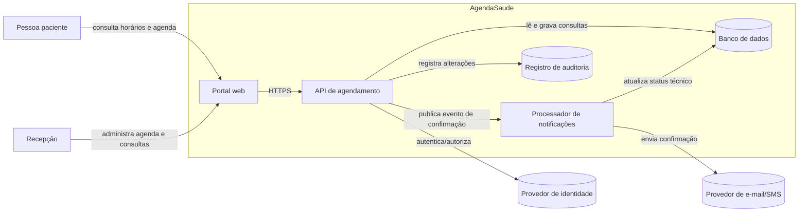
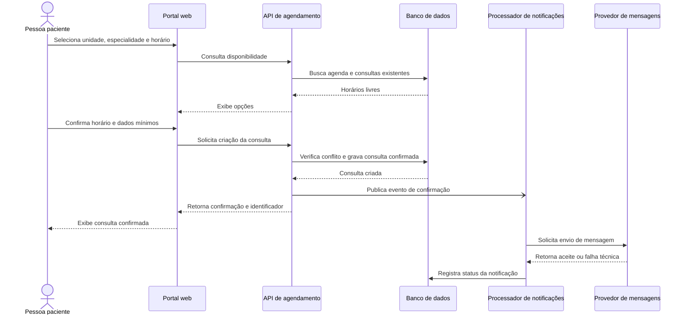

# AgendaSaude: discovery de arquitetura

> Exercício de documentação com a abordagem **diagrams as code**.

## 1. Sistema escolhido

O sistema escolhido é uma plataforma de agendamento de consultas para uma clínica de pequeno porte. A pessoa paciente consulta horários disponíveis, solicita um agendamento e recebe confirmação. A recepção também pode criar, remarcar ou cancelar consultas em nome da pessoa paciente.

O objetivo desta etapa não é definir a implementação completa, mas construir uma base de contexto que um agente de desenvolvimento possa consultar sem precisar inventar o contorno do sistema.

## 2. Descrição em linguagem natural

### Escopo

- cadastro e identificação de pacientes;
- cadastro de profissionais, especialidades e unidades;
- configuração de agendas e horários bloqueados;
- consulta de disponibilidade;
- criação, confirmação, remarcação e cancelamento de consultas;
- envio de notificações por e-mail ou SMS;
- visão operacional da agenda pela recepção;
- registro básico de auditoria das alterações.

### Nível da visão

Esta é uma visão de **containers**, inspirada no modelo C4. Ela mostra pessoas, sistemas externos e os principais blocos executáveis ou armazenáveis do produto. Não define classes, endpoints, tabelas ou infraestrutura de produção.

### Limites e responsabilidades

O **AgendaSaude** é responsável por regras de disponibilidade, conflitos de agenda, ciclo de vida do agendamento e autorização dos perfis paciente e recepção.

Ficam fora deste limite: prontuário clínico, cobrança, faturamento de convênios, telemedicina, prescrição, gestão de estoque e confirmação de identidade forte. Esses temas podem ser integrações futuras, mas não são decisões deste discovery.

### Integrações

- **Provedor de identidade**: autenticação e recuperação de acesso.
- **Provedor de mensagens**: entrega de e-mail/SMS; o AgendaSaude registra o pedido e o resultado técnico, mas não controla a entrega final.
- **Calendário externo**: integração futura para sincronizar indisponibilidades dos profissionais; ainda não faz parte do fluxo principal.

### Restrições conhecidas

- dados de saúde e identificação devem ser tratados conforme a LGPD e o princípio do menor privilégio;
- uma consulta não pode ocupar o mesmo horário de um profissional na mesma unidade;
- alterações de agenda precisam deixar trilha de auditoria;
- uma falha no provedor de mensagens não deve desfazer um agendamento já confirmado;
- o sistema precisa funcionar em navegador de celular e desktop;
- o fuso horário da unidade deve ser explícito para evitar confirmações ambíguas.

### Lacunas

Ainda não foram decididos: política de retenção e anonimização, provedores concretos, método de autenticação, modelo de autorização detalhado, duração variável das consultas, regras de feriados, política de no-show, limites de reenvio de mensagens, requisitos de disponibilidade e estratégia de migração de dados legados.

## 3. Diagramas

Os diagramas são arquivos versionados em [`docs/containers.mmd`](docs/containers.mmd) e [`docs/sequence-agendamento.mmd`](docs/sequence-agendamento.mmd). Os mesmos blocos estão incorporados abaixo para que o README seja autossuficiente no GitHub.

### 3.1 Visão estrutural: containers



### 3.2 Visão comportamental: agendamento



## 4. Como a IA foi usada

Prompt resumido utilizado:

> Gere uma visão estrutural inspirada em C4 e um diagrama de sequência Mermaid para uma plataforma de agendamento de consultas. Considere paciente, recepção, autenticação, disponibilidade, persistência e notificação. Declare escopo, limites, integrações, restrições e lacunas. Não invente prontuário, cobrança ou regras de negócio não informadas.

A primeira geração foi tratada como rascunho. A revisão humana foi necessária para:

- trocar uma representação genérica de “sistema de agenda” por containers com responsabilidades distintas;
- explicitar a recepção como ator, pois o fluxo não é apenas self-service;
- separar o processador de notificações da API, evitando que falha de e-mail reverta o agendamento;
- adicionar o registro de auditoria, a restrição de fuso horário e o requisito de LGPD;
- marcar calendário externo, cobrança e prontuário como fora de escopo, em vez de sugeri-los como funcionalidades existentes;
- deixar claro que disponibilidade precisa ser revalidada no momento da gravação para evitar conflito concorrente.

## 5. O que foi inferido e o que permanece decisão

A IA inferiu corretamente que o fluxo crítico passa por consulta de disponibilidade, persistência do agendamento e notificação assíncrona. Também identificou atores e integrações naturais para esse domínio.

Eu precisei ajustar a fronteira do sistema e impedir que o diagrama tratasse a entrega de mensagem como parte transacional do agendamento. Também precisei retirar decisões que seriam apenas suposições, como provedor específico, duração fixa de consulta e autenticação por senha.

Para um agente construir o sistema sem inventar decisões, esta documentação ainda precisa de: histórias de usuário e critérios de aceite; glossário; modelo de domínio; contrato de API; estados e transições do agendamento; matriz de permissões; regras de timezone e recorrência; requisitos não funcionais mensuráveis; decisões sobre provedor e infraestrutura; exemplos de erros; dados de teste; e política de observabilidade, backup, retenção e recuperação.

## 6. Toy problem: reposicao de estoque

### Problema e contrato

Receber uma sequência fictícia de produtos e devolver uma lista de reposição. Cada produto tem nome, quantidade disponível e estoque mínimo.

- **Entrada:** iterável de `ProdutoEstoque(nome, quantidade_disponivel, estoque_minimo)`.
- **Saída:** lista ordenada de `ItemReposicao(nome_produto, quantidade_repor)`; inclui apenas itens abaixo do mínimo.
- **Regra:** `quantidade_repor = estoque_minimo - quantidade_disponivel` quando disponível < mínimo.
- **Limite:** no mínimo exato ou acima, não incluir o produto; iterável vazio retorna `[]`.
- **Validação:** nome deve ser texto não vazio; quantidades devem ser inteiros não negativos. Tipos incompatíveis geram `TypeError`; valores inválidos, `ValueError`. Booleanos não são aceitos como inteiros. A ordem original e o texto do nome são preservados.

Exemplos esperados:

```python
calcular_reposicao([ProdutoEstoque("Cafe", 3, 10)])
# [ItemReposicao(nome_produto='Cafe', quantidade_repor=7)]

calcular_reposicao([ProdutoEstoque("Cha", 10, 10)])  # []: no limite
calcular_reposicao([])  # []: sem produtos
ProdutoEstoque("Cafe", -1, 10)  # ValueError
ProdutoEstoque("Cafe", 3, 2.5)  # TypeError
```

### Orientações de geração

Instrução usada para guiar a implementação e a revisão:

> Implemente em Python uma função para a especificação de reposição acima. Use nomes claros em português, funções com uma responsabilidade, comentários apenas para lógica não óbvia e erros explícitos com mensagens acionáveis. Preserve a ordem de entrada. Separe erros de tipo (`TypeError`) de valores inválidos (`ValueError`), rejeite `bool` como quantidade inteira e valide todos os dados antes de calcular. Não inclua credenciais ou dados reais. Use somente a biblioteca padrão; não adicione dependências sem necessidade. Escreva testes para casos normais, limites e erros. Não altere as regras de negócio.

O agente específico **“Desenvolvedor de Software” do Fórum 1** não estava disponível na lista de agentes desta sessão. Por isso, não atribuo a ele a autoria da implementação. A solução foi elaborada com as instruções acima e submetida a uma revisão independente disponível nesta sessão.

### Revisão crítica

Na leitura própria, verifiquei se os nomes descreviam os conceitos, se a função principal tinha responsabilidade única, se os comentários eram necessários, se os erros eram previsíveis, se os dados eram validados, se havia segredos e se dependências externas eram justificáveis. `ProdutoEstoque` valida seus dados; `calcular_reposicao` percorre, seleciona e calcula; `ItemReposicao` representa a saída. Não há comentários narrativos, credenciais nem dependências de terceiros.

A revisão independente apontou:

- **[bloqueia]** `reposicao_estoque.py`, validação de `nome`: o teste combinado classificava nome de tipo incorreto como `ValueError`, embora a instrução defina `TypeError` para tipo incompatível e `ValueError` para texto vazio. Isso afeta o contrato de erro, não o cálculo de reposição.

Aceitei o apontamento. Antes, tipo incorreto e texto vazio compartilhavam uma condição e a mesma exceção:

```python
if not isinstance(self.nome, str) or not self.nome.strip():
    raise ValueError("nome deve ser um texto nao vazio")
```

Depois, os casos têm validações distintas e teste próprio:

```python
if not isinstance(self.nome, str):
    raise TypeError("nome deve ser um texto")
if not self.nome.strip():
    raise ValueError("nome deve ser um texto nao vazio")
```

Também ampliei os testes para cobrir estoque mínimo negativo. A revisão não sugeriu mudanças que alterassem as regras de negócio. Nenhum ajuste foi feito apenas para reduzir linhas ou multiplicar funções.

### Verificação

Executado com Python 3 usando apenas a biblioteca padrão:

```text
python3 -m unittest -v test_reposicao_estoque
Ran 12 tests in 0.001s
OK
```

Os testes cobrem quantidade de reposição, ordem, igualdade ao mínimo, acima do mínimo, lista vazia, quantidades negativas, tipos inválidos, booleano, nome vazio e item/coleção de tipo incorreto. A verificação de sintaxe do Pylance também não encontrou erros nos dois arquivos Python.

### Reflexão para a equipe

Eu incorporaria à geração e revisão um contrato explícito entre **tipo inválido** e **valor inválido**, junto com testes derivados dos exemplos e limites da regra de negócio. Isso reduz ambiguidades em APIs e torna os erros verificáveis. Para colocar em prática, a equipe precisaria incluir esses critérios nos prompts/templates de tarefa e reservar uma etapa curta de revisão de contrato e testes no pull request, antes da aprovação; os testes automatizados devem rodar no CI.
